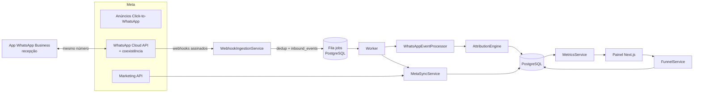

# Arquitetura

## Visão geral

## Camadas

| Camada | Responsabilidade | Depende de |
|---|---|---|
| `domain/` | Tipos, enums, erros, rótulos em português | nada |
| `ports/` | Interfaces de repositório (`Repos`) | domain |
| `modules/` | Regras de negócio (atribuição, funil, métricas, integrações) | ports, domain |
| `infra/` | Prisma, memória, criptografia | ports |
| `queue/` | Fila persistente e worker | — |
| `http/` | Rotas Fastify, validação Zod, RBAC | modules |

O domínio não importa Prisma nem Fastify. Por isso todos os cenários são testados com repositórios em memória (com rollback de transação), e a troca de banco ou framework HTTP não afeta as regras.

## Integração WhatsApp desacoplada

`WhatsAppProvider` é a porta. Adaptadores:

- **`CloudApiAdapter`** — Meta direta (Graph API). Valida `X-Hub-Signature-256` com o App Secret.
- **`PartnerCoexistenceAdapter`** — parceiro oficial (BSP) que entrega o payload no formato Meta. URL, cabeçalho de autenticação, forma de assinatura do webhook e envelope são configuráveis.

Ambos convertem o payload em `NormalizedEvent` (mensagem recebida, echo do app, status, contato, histórico, atualização de conta). Um parceiro com formato próprio exige apenas um novo adaptador.

## Fluxo de um webhook

1. `POST /webhooks/whatsapp/:kind` recebe o corpo **bruto**.
2. Assinatura inválida → 401, erro registrado na tela de integrações.
3. O payload é normalizado; cada evento ganha uma `dedupKey` (ex.: `msg:<wamid>`, `echo:<wamid>`, `status:<wamid>:<status>`).
4. `inbound_events` tem índice único em `dedupKey`: eventos repetidos são descartados.
5. Um job `whatsapp.process-event` é enfileirado; a resposta 200 sai imediatamente.
6. O worker processa dentro de uma transação. Falha → retry com backoff exponencial (5s, 10s, 20s… até 1h). Esgotadas as tentativas → `DEAD`, com botão “Reprocessar”.
7. Uma rotina varre eventos `RECEIVED` sem job (queda entre gravar e enfileirar).

## AttributionEngine

Executa os 9 passos da diretriz para cada mensagem recebida:

1. Identificar o contato (wa_id; BSUID quando houver usernames).
2. Verificar cadastro existente.
3. Identificar `referral`.
4. Extrair `source_id` quando `source_type = "ad"`.
5. Localizar o anúncio sincronizado. Se ainda não existir, a atribuição é registrada com o ID e a hierarquia é completada na próxima sincronização da Meta (`resolvePendingHierarchy`).
6. Associar campanha e conjunto.
7. Registrar `AttributionEvidence` (com `ctwa_clid`, título, URL e payload bruto).
8. Atualizar lead e funil.
9. Persistir (o painel lê direto do banco).

**Quando um lead é criado**

| Situação | Resultado |
|---|---|
| Contato novo | Novo lead |
| Mensagem com referral de anúncio e sem lead aberto | Novo lead (nova oportunidade) |
| Contato com lead aberto | Mensagem vai para o lead existente |
| Paciente antigo (importado do app) sem referral | Nenhum lead novo; mensagem registrada |
| Último lead fechado há mais de `LEAD_REOPEN_AFTER_DAYS` | Novo lead com origem desconhecida |

**Níveis de confiança:** `OFFICIAL_REFERRAL` > `MANUAL` > `UNKNOWN`. A atribuição manual não substitui uma oficial. Uma referência oficial atrasada substitui uma manual. Com duas referências oficiais, vale a de **ocorrência** mais antiga (primeiro toque), não a de chegada.

## Eventos fora de ordem

- Datas de lead, conversa e contato usam o horário do WhatsApp (`timestamp`), não o de chegada.
- A janela da conversa é estendida para trás quando chega uma mensagem mais antiga.
- Uma resposta (echo) que chega antes da mensagem do paciente é ligada ao lead quando ele é criado.
- O status de mensagem nunca regride (`read` não volta para `delivered`).
- Um status de mensagem ainda desconhecida é retentado e, se ela nunca chegar, marcado como `IGNORED`.

## Segurança

- JWT HS256 com expiração; senhas com scrypt; RBAC por permissão (ADMIN, MANAGER, RECEPTIONIST, VIEWER).
- No navegador, o token fica em **cookie httpOnly**; o Next faz proxy para a API.
- Credenciais de integração cifradas com AES-256-GCM (`CREDENTIALS_ENCRYPTION_KEY` fora do banco) e exibidas mascaradas.
- Auditoria de todas as alterações comerciais, de atribuição e de integração, com remoção automática de campos sensíveis.
- Limite de tentativas de login; cabeçalhos de segurança no frontend.

## Concorrência

Duas mensagens simultâneas de um contato novo podem disputar a criação do contato. A restrição única em `contacts.waId` faz a segunda transação falhar, e o retry a processa com o contato já existente. Nenhum dado fica duplicado.
